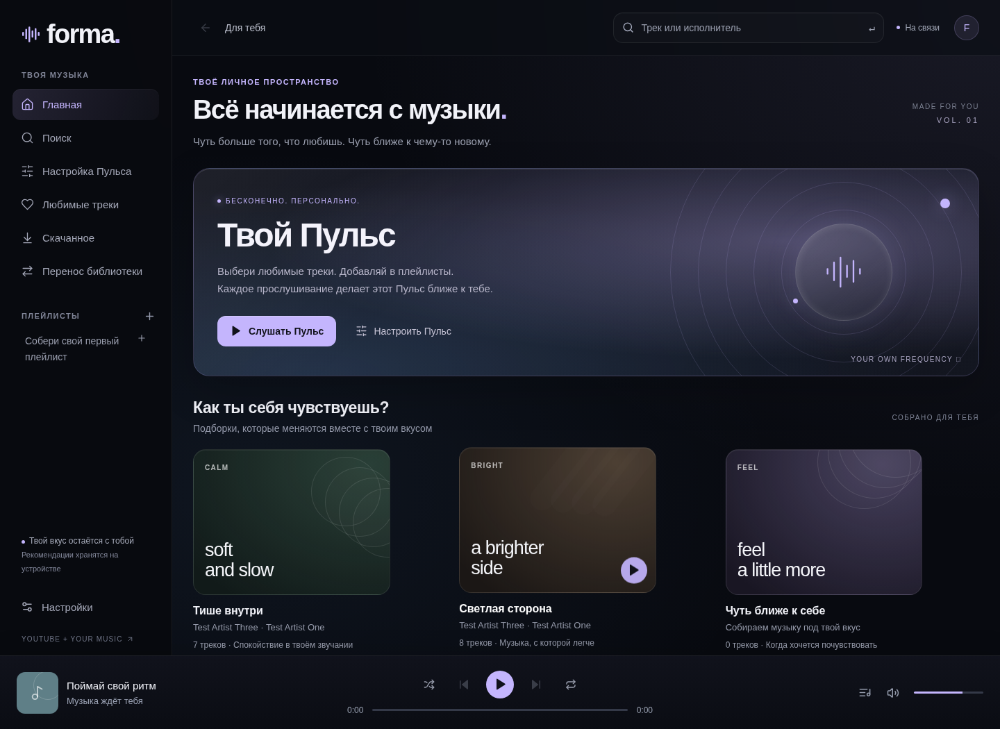
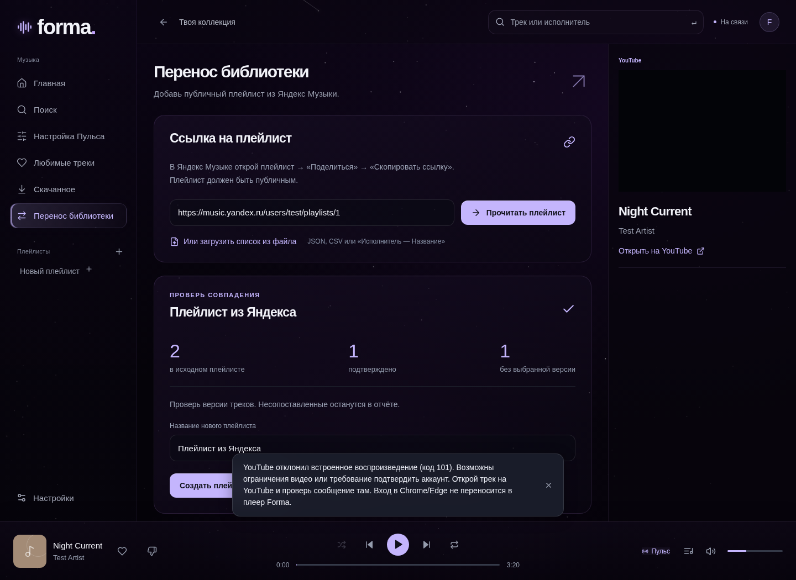
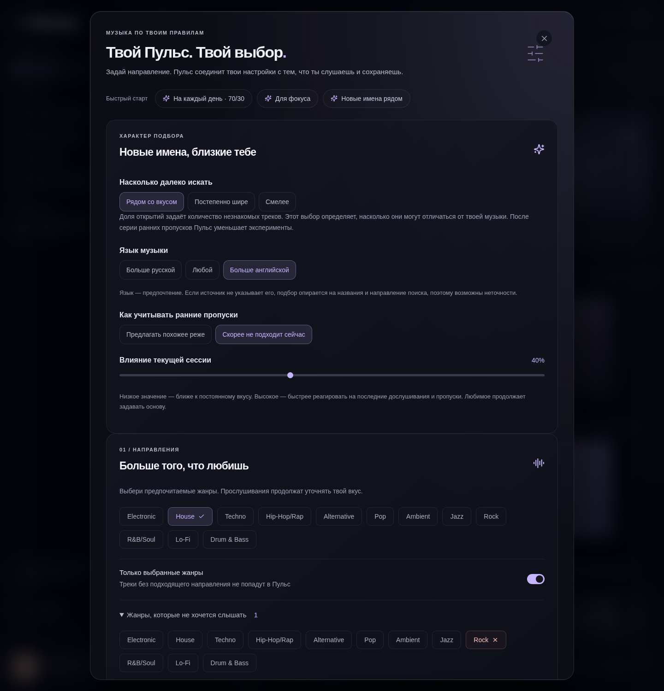

# Forma — музыка в твоём ритме

**Windows 1.20.0 / iOS 1.12.0:** встроена нейромодель анализа звучания, усилена личная релевантность и добавлены строгие исключения. [Описание](docs/NEURAL_RECOMMENDATIONS.md) · [Итоговая проверка EXE и IPA](docs/NEURAL_VALIDATION_1_20.md).


В **Windows 1.19.1 / iOS 1.11.1** Пульс отдельно ищет свежие релизы близких артистов, проверяет дату конкретной записи и учится по реакции на новинки. Глобальные подборки известных песен не подменяют личные музыкальные связи; общий жанр и давняя популярность не дают приоритета над подходящей находкой. Знакомые 30% используют все лайки и сохранённые плейлисты. [Как устроено и что проверено](docs/PULSE_1_19_1.md).

В **iOS 1.9.1** исправлены жанровые веса источников, допуск фоновых загрузок и обучение от исключённых записей. [Прогон рекомендаций](ios/RECOMMENDATION_AUDIT_1_9_1.md) · [Алгоритм](ios/RECOMMENDATIONS.md).

В **Windows 1.17.0** и **iOS 1.8.0** исправлены рекомендации: жанры поисковых запросов больше не обучают вкус, а язык и разнообразие не добавляют посторонние песни. Фоновая сверка с публичным каталогом iTunes уточняет жанр только при точном совпадении записи. [Подробности и проверки](docs/GENRE_RELEVANCE.md).

Музыкальное приложение для Windows 10/11 x64: **YouTube онлайн, свои файлы офлайн**, персональный **Пульс** и перенос публичных плейлистов из Яндекс Музыки. Крупный текст, почти чёрный фон, стеклянные панели, мягкие градиенты и шесть цветовых палитр. Громкость меняется плавно с шагом 0.001: звук реагирует во время движения, профиль сохраняется после отпускания.

**[Скачать Forma 1.20.0 для Windows](https://github.com/Astronomial/music/releases/download/win-v1.20.0/Forma-1.20.0-Windows-x64.exe)** · [SHA-256](https://github.com/Astronomial/music/releases/download/win-v1.20.0/Forma-Windows-SHA256SUMS.txt) · [Что изменилось](CHANGELOG.md)

Portable `.exe`: установка и Node.js не нужны. Данные предыдущей версии сохраняются в том же профиле пользователя. Сборка не подписана сертификатом издателя.



*Скриншоты сделаны с проверочным каталогом. Тестовые треки и заглушки плеера не входят в приложение.*

В Windows 1.15.5 удалены правая видеопанель, статус сети и дублирующий пункт Пульса. YouTube играет как аудио, любимые треки показаны от новых к старым, падающие звёзды появляются чаще. Боковую панель можно свернуть до иконок кнопкой рядом с логотипом; повторное нажатие возвращает подписи. Режим сохраняется на ПК. Названия разделов и плейлистов доступны при наведении. Галактика, прозрачные панели и звёзды сохранены. [Проверка исправления воспроизведения](docs/PLAYBACK_FIX_1_15_5.md).

## Начать слушать

1. Запусти `Forma-1.19.1-Windows-x64.exe` и выбери любимые направления.
2. Найди трек или исполнителя в строке наверху. Поиск срабатывает при вводе; доступны вкладки «Всё», «Треки» и «Исполнители», лучшее совпадение и страницы артистов.
3. Слушай Пульс, сохраняй любимое и собирай плейлисты. Сохранения, дослушивания и ранние пропуски меняют следующий выбор.
4. Для офлайна открой «Скачанное» → «Добавить файлы» или «Добавить папку». Forma скопирует музыку в свою библиотеку и прочитает название, артиста, альбом, жанр, BPM и обложку, если они есть в тегах.
5. Нажми «Настроить» под галактикой Пульса: задай жанры, характер музыки, артистов и интервалы повторов. В обычных настройках выбери палитру и размер текста.

YouTube играет через **аудиопоток без видеопанели**. Извлечение доступного публичного аудио и передача потока выполняются в главном процессе; интерфейс получает адрес собственного протокола Forma. Ссылки следующих трёх треков извлекаются заранее: это уменьшает ожидание извлечения, но не означает полного буфера аудио. Сворачивание Forma не ставит музыку на паузу. Закрытие окна завершает приложение. Подписка не нужна; неофициальное получение потоков зависит от изменений и доступности YouTube. Приватные и требующие входа ролики не поддерживаются. Открыть оригинал можно через меню трека. Для офлайна используются свои музыкальные файлы; уже сохранённые файлы прежних версий остаются доступны.

Поддерживаемые локальные форматы: MP3, FLAC, WAV, OGG/Opus, M4A/MP4, если кодек поддерживается Electron. До 350 МБ на файл, до 2000 файлов за один выбор папки, 10 ГБ на хранилище. Копии определяются по содержимому, поэтому повторный импорт файла не создаёт дубликат. Исходные файлы не изменяются и не удаляются.

Горячие клавиши: `Пробел` — пауза; `Ctrl+→` — следующий трек; `Ctrl+←` — предыдущий. Пробел на кнопке активирует её; вне элементов управления ставит музыку на паузу. Горячие клавиши не мешают вводу текста и модальным окнам. `Alt+←` возвращает на предыдущий экран.

## Перенос из Яндекс Музыки

«Перенос библиотеки» → вставь ссылку, полученную через «Поделиться» у **публичного плейлиста**. Поддерживаются современные ссылки `/playlists/UUID`, ссылки `/users/имя/playlists/номер`, адрес iframe и его HTML-код (из него читается только адрес). Аккаунт, пароль и OAuth-токен не нужны.

Приложение читает названия и исполнителей, показывает состав плейлиста, а затем ищет соответствующие треки в выбранном каталоге — по умолчанию YouTube. Название, артист, длительность и версия проверяются вместе. Высокоуверенные совпадения выбираются автоматически; спорные версии можно послушать и выбрать вручную. Кавер или ремикс не подменяет оригинал автоматически.

После проверки создаётся отдельный плейлист. Его треки сразу учитываются волной. Ненайденные и пропущенные треки остаются в отчёте; отчёт доступен в истории переносов и скачивается в JSON. Отчёт можно скачать даже тогда, когда не найдено ни одного совпадения. При неполном ответе Яндекса импорт останавливается, чтобы не потерять часть списка.

Ссылки читаются через неофициальный интерфейс метаданных Яндекс Музыки. Сервис может ограничить анонимный доступ, вернуть 403 или изменить формат ответа. В этом случае доступен резервный импорт JSON, CSV/TSV и TXT. Примеры находятся в [examples](examples). До 5000 треков и 10 МБ за один импорт. Музыка из Яндекса не скачивается.

### Плейлист «Мне нравится» Astronomial

Для конкретной пользовательской ссылки `/playlists/lk.7658af97-0bd8-43ef-a8ed-85f39757d258` известен адрес из предоставленного владельцем iframe: `/users/Astronomial/playlists/3`. В Electron перенос ставится в очередь один раз и начинается при подключении к YouTube. Сначала пробуется публичный API метаданных, затем публичный web-handler плейлиста. При ошибке главная показывает причину и кнопку повторения. Состояние сохраняется между запусками.

После получения списка сохраняются **все реальные названия и артисты**, включая треки без доступной версии. Точные совпадения становятся воспроизводимыми; остальные помечены «Нужна версия в YouTube» и доступны для проверки. Они не включаются в очередь. Неполученный список не заменяется выдуманными треками. **В среде сборки получить реальный плейлист не удалось; автоматический перенос проверен на тестовых ответах, но его успех на живом Яндексе не подтверждён.**



## Настройка Пульса

Раскрывающееся стеклянное окно по кнопке «Настройка Пульса»; Escape, крестик или нажатие на фон сворачивают его. Настройки сохраняются автоматически и влияют на следующий выбор. Текущий трек не прерывается. Предпросмотр показывает подходящие треки с объяснениями; при изменении направлений каталог обновляется с небольшой задержкой.

- **Жанры:** предпочитаемые и исключённые направления; «Только выбранные жанры» ограничивает волну подходящими направлениями. Исключения имеют приоритет над сохранениями.
- **Характер:** настроение, энергия и наличие вокала. Это предпочтения для поиска и ранжирования. Метаданные и теги сильнее поискового контекста; отсутствие BPM или вокальных тегов не считается подтверждением соответствия.
- **Характер подбора:** «Рядом со вкусом», «Постепенно шире» или «Смелее»; предпочтение русского/английского языка; строгость ранних пропусков и влияние текущей сессии.
- **Открытия и разнообразие:** отдельные регуляторы знакомого/нового и повторения артистов в очереди.
- **Повторы:** без интервала, 30 минут, 2 часа, 6 часов или сутки. Интервал считается от начала воспроизведения; текущий трек исключён из следующего выбора. Явная кнопка повтора имеет приоритет.
- **Сохранённая музыка:** можно убрать любимые и треки плейлистов из волны, сохранив их влияние на вкус.
- **Артисты:** ориентиры получают дополнительный приоритет; исключённые артисты не попадают в волну, но остаются доступны для ручного прослушивания.
- **Плейлисты:** учитывать все либо только отмеченные. Любимое и история учитываются независимо от выбранных плейлистов.

Пресеты «На каждый день · 70/30», «Для фокуса», «Новые имена рядом» меняют характер и ритм, сохраняя твои жанры и списки артистов. «Сбросить настройки Пульса» возвращает только его параметры: библиотека, история и оформление сохраняются. Если ограничения не оставляют подходящих треков, приложение показывает пустой результат.

У YouTube часто нет достоверного жанра: жанр поискового запроса не считается подтверждённым жанром записи. Настроение, энергия и вокал тоже не гарантируются; теги локальной музыки дают более точный подбор.



## Как работает волна

В версии 1.7 начальная цель — **70% находок и 30% знакомой музыки**, преимущественно русскоязычные новые исполнители рядом со вкусом. Баланс учитывает реально включённые треки между пересчётами, а серия ранних пропусков уменьшает эксперименты. Новая локальная модель учится по сочетанию признаков и реакции на выбранную рекомендацию; крупная коллекция одного артиста больше не подавляет небольшие интересы.

Это собственная локальная система Forma, а не модель Spotify. Она сочетает профиль вкуса, сходство с несколькими сохранёнными треками и разнообразие артистов. Качество зависит от накопленных сигналов и доступного каталога.

Для YouTube кандидаты поступают из музыкальных очередей похожих треков вокруг сохранений и плейлистов, поиска по любимым направлениям и артистам из локальной библиотеки. Веса, ранжирование и выбор следующего трека считаются на устройстве. На YouTube отправляются запросы с названиями/артистами и идентификаторами опорных треков, а не вся библиотека или числовой профиль. Публичные музыкальные очереди не являются персональными рекомендациями аккаунта YouTube.

У YouTube часто отсутствуют жанры, BPM и настроение. Forma не выдумывает эти поля: связь с опорным треком и артистом используется напрямую, а направление поискового запроса — как слабый дополнительный сигнал. Локальные теги дают более подробные признаки. Шесть подборок по настроению используют тот же профиль: «Тише внутри», «Светлая сторона», «Чуть ближе к себе», «На полной», «Без лишних мыслей», «После полуночи». Реальные прослушивания, пропуски и сохранения из них меняют общий Пульс; показ карточки не обучает профиль.

Изучены первичные источники Spotify, YouTube Music, Deezer и Яндекса о контексте, обратной связи, открытиях и разнообразии. Добавлены многокластерные опоры, профиль последних 90 минут, локальное обучение по признакам рекомендаций и калибровка последовательности. Это собственная локальная реализация этих принципов: закрытые модели Spotify, многопользовательские данные и анализ аудио недоступны. [Архитектура, формулы, первоисточники и ограничения](docs/recommendations.md).

| Действие | Влияние |
| --- | --- |
| Сохранить в любимое | +5 постоянного веса |
| Добавить в плейлист | +3 за плейлист, постоянный вес ограничен 9 |
| Прослушать не менее 80% | +1.5 |
| Прослушать 50–80% | +0.5 |
| Пропустить после ≥3 секунд звучания, до 30 секунд и до 25% длительности | −2.5 |
| Пропустить после ≥3 секунд звучания, до 65% | −0.8 |
| Переключить после 65% | Без отрицательного сигнала |
| «Не рекомендовать» | Исключить трек до отмены |
| Ошибка сети, плеера или переключение до 3 секунд звучания | Без отрицательного сигнала |

Прослушанные секунды считаются отдельно от перемотки. Неявные сигналы ослабевают вдвое каждые 30 дней и ограничиваются диапазоном −7…+4 для каждого трека. Один пропуск не исключает весь жанр. Ранжирование учитывает несколько интересов, последние прослушивания, баланс знакомого/нового и штрафы за повторяющихся артистов. После изменений предпочтений каталог обновляется с задержкой; следующий трек ранжируется заново после каждого переключения.

Разнообразие сохраняется между пересчётами. Пульс учитывает последние 12 включённых треков за 90 минут и текущего исполнителя, даже если трек сразу пропущен. При стандартных настройках и достаточном числе подходящих альтернатив между треками одного артиста стоят минимум три других, а в окне из 12 треков он появляется максимум дважды. На максимальном разнообразии интервал больше. Если подходящих артистов мало, ограничения постепенно смягчаются; запреты жанров/артистов остаются в силе. Значение «Разнообразие артистов = 0» отключает эти ограничения.

Доля открытий теперь учитывает и **новых исполнителей**, а не только новые треки знакомого артиста. Названия артистов, каналы и совместные записи сопоставляются; одинаковые записи с разными YouTube ID объединяются, но ремиксы и живые версии сохраняются отдельно. Для поиска открытий используются похожие треки новых артистов, связанных с твоими опорами, и следующие страницы жанрового поиска. Качество зависит от того, что возвращает каталог; незнакомая музыка не гарантированно понравится.

Офлайн-волна и поиск используют локальные файлы и доступные загрузки. Любимые треки, плейлисты, история, настройки, импорт и скачанная музыка сохраняются между запусками.

## Источники и хранение

**YouTube:** `youtubei.js` читает публичный музыкальный каталог и получает доступные аудиопотоки без входа и API-ключа. Это неофициальный интерфейс: формат ответов и доступность могут изменяться. Потоки ограничены HTTPS-хостами Google Video, аудио передаётся постепенно с поддержкой перемотки; истёкшая ссылка обновляется один раз. В 1.15.5 аудио определяется по MIME без зависимости от необязательных метаданных, поддержан резервный HLS-поток. Перед выбором источника проверяется начало аудио. Адреса потоков хранятся только в ограниченном временном кеше. Если сервис недоступен, локальная библиотека продолжает работать.

Профиль и музыка находятся в пользовательском каталоге приложения (`%APPDATA%\Forma` либо каталог Electron с именем пакета). «Открыть папку» показывает точное расположение музыки. Библиотека пишется атомарно, предыдущая версия остаётся в `.bak`. Экспорт исключает API-ключ. Авторизация в YouTube и Яндексе не используется.

## iPhone и синхронизация

**[Скачать Forma iOS 1.12.0 (IPA для подписи)](https://github.com/Astronomial/music/releases/download/ios-v1.12.0/Forma-iOS-1.12.0-unsigned.ipa)** · **[Установка с Windows через Sideloadly](ios/INSTALL_WINDOWS.md)**

В 1.6.1 космическая тема Windows перенесена на iPhone: галактика Пульса, звёзды, полупрозрачные панели и навигация только иконками. Дизлайк текущего трека сразу переключает очередь. [Проверка сборки и снимки интерфейса](docs/RELEASE_VALIDATION_IOS_1_6.md).

В 1.5.0 подборки используют общие с ПК правила настроения и русские названия: [как отбираются песни](docs/MOOD_COLLECTIONS.md).

Нативное приложение для iOS 17+, включая iOS 18: SwiftUI, AVQueuePlayer, фоновый Пульс, системное управление, поиск, плейлисты, подборки и настройки разнообразия. В 1.1.0 перенесены принципы Пульса ПК 1.7: баланс 70/30, близкие новые исполнители, локальное обучение контекста, язык и сессионные реакции. В 1.1.2 исправлены гонки очереди и сохранений, восстановление аудиосистемы и ложное подтверждение старта; [аудит iOS](ios/STABILITY_AUDIT.md). Начало до трёх следующих треков готовится параллельно, включая мобильную сеть и режим экономии данных iOS. При выборе ещё загружающегося трека сохраняется его плеер и накопленный буфер; свежие адреса остальных треков не удаляются при смене приоритета. Музыкальная подписка не нужна; бесплатная личная подпись для установки обычно действует 7 дней и требует обновления.

В Windows 1.11.1 и iOS 1.5.0 Google удалён. **[Обмен по Wi-Fi](docs/WIFI_SYNC.md)**: подключение одноразовым кодом, просмотр изменений и подтверждение каждого пакета на ПК или iPhone. Одного подтверждения достаточно; новые изменения сами не переносятся. Переносятся плейлисты, лайки/дизлайки, история с контекстом, настройки Пульса и акустические профили; музыкальные файлы остаются на устройстве. Дизлайк даёт треку последний приоритет, а фоновый DSP-анализ настоящего аудио помогает выбирать музыку по звучанию: [алгоритм и ограничения](docs/SOUND_RECOMMENDATIONS.md).

Xcode CI проверяет сборки симулятора и устройства, настоящую нативную очередь в фоне на тестовом аудио и TLS-синхронизацию. Живой YouTube и блокировку физического iPhone необходимо проверить после установки. Неофициальное получение потоков может перестать работать при изменениях YouTube. [Подробности iOS](ios/README.md) · [Использованный открытый код](ios/THIRD_PARTY.md).

## Быстрое переключение и Пульс от плейлиста

В версии 1.4 плеер YouTube сохраняется между треками, расчёты рекомендаций выполняются в фоновом worker, а повторные запросы похожей музыки и адресов воспроизведения используют короткий кеш. Каталог появляется порциями; строки библиотеки не перерисовываются целиком на каждом обновлении времени.

Открой плейлист из своей библиотеки и нажми **«Пульс от плейлиста»**. Подборка ищет музыку по его трекам, артистам и направлениям. Другие сохранённые плейлисты не становятся её основой; история слушания и пропуски продолжают обучать общий профиль. Исключения и интервал повторов соблюдаются. Названия из Яндекса без найденной версии могут служить ориентирами по артисту, но сами не воспроизводятся.

В версии 1.7 на синтетическом наборе 6000 треков и 45 сохранений расчёт 30 рекомендаций занял 216 мс, шести подборок — 393 мс на машине сборки. Для MMR отбираются сильные кандидаты от каждого исполнителя, чтобы разнообразие не замедляло переключение. Это проверка вычислений, а не замер загрузки YouTube или гарантия скорости другого ПК. Повторить замер: `node scripts/benchmark-recommendations.mjs`.

## Разработка и проверки

Node.js 24 и npm:

```powershell
npm ci
npm run desktop
```

```powershell
npm run dev             # браузерный предпросмотр UI; YouTube и файлы требуют Electron
npm run build           # production UI
npm test                # алгоритмы, парсеры, поиск, импорт и файловое хранение
npm run test:ui         # npm run dev отдельно; Chromium через CHROMIUM_PATH
npm run test:desktop    # настоящий Electron; в Linux без DISPLAY используется headless Ozone
npm run evaluate:recommendations # синтетическая последовательная оценка
npm run dist:win        # portable Windows x64
npm run dist:installer  # NSIS-установщик, предпочтительно на Windows
```

- **168 модульных тестов ПК**: рекомендации и жанровые доказательства, ранние пропуски и дизлайки, парсеры, импорт, поиск, хранение и подтверждаемый Wi-Fi обмен.
- **Семь сценариев интерфейса**: настройки и библиотека, два столбца поиска и исполнители, Пульс по треку, настроение, разнообразие, громкость, клавиатура, дизлайк, офлайн и восстановление.
- **Нативный Electron в Linux и Windows**, включая запуск упакованного приложения: настоящее AAC/HLS аудио с контролируемым сервером, перемотка, резерв воспроизведения, фон, быстрое переключение, сохранение и Wi-Fi подтверждение.
- Скачанный Windows EXE проверяется по SHA-256 и содержимому упакованных модулей. [Проверки текущих рекомендаций и релизов](docs/GENRE_RELEVANCE.md).
- Живые YouTube и iTunes недоступны из среды сборки по сетевой политике: каталог проверяется контролируемыми ответами, медиаплеер — настоящим аудио. Это не проверка доступности сервисов на каждой пользовательской сети.

[Космическая тема Windows 1.12.0](docs/RELEASE_VALIDATION_1_12.md) · [Рекомендации Windows 1.11.1 / iOS 1.5.0](docs/RELEASE_VALIDATION_MOODS.md).

GitHub Actions проверяет ядро и собирает Windows portable из исходников. Главные модули: `src/core/recommender.mjs`, `catalog.mjs`, `youtube.mjs`, `search.mjs`, `library-import.mjs`; нативные файлы и аудиопротокол — `electron/local.cjs` и `electron/offline.cjs`.

Документация источников: [YouTube.js](https://ytjs.dev/), [неофициальный Yandex Music API](https://github.com/MarshalX/yandex-music-api).

Если YouTube просит подтвердить, что ты не бот, или вход из плеера не открывается: [диагностика и ограничения входа](docs/YOUTUBE_ACCESS.md). Встроенный плеер и обычный браузер имеют отдельные сессии.
